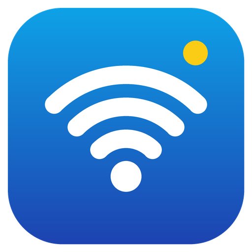

<p align="center">
  
</p>

<h1 align="center">WiFi Scanner MCP</h1>

<p align="center">
  <b>Give Claude eyes on the Wi-Fi around you.</b><br>
  Scan nearby networks, compare signal strength, find the least crowded router channel and spot insecure networks: just by asking.
</p>

<p align="center">
  
  
  
  
  
  
</p>

<p align="center">
  <a href="https://github.com/Swedishwizards/wifi-scanner-mcp/releases/latest"></a>
  <a href="https://github.com/Swedishwizards/wifi-scanner-mcp/actions/workflows/ci.yml"></a>
  <a href="https://github.com/sponsors/Swedishwizards"></a>
</p>

---

A [Model Context Protocol](https://modelcontextprotocol.io) server that lets **Claude Desktop, Claude Code** and any other MCP client scan Wi-Fi networks on **macOS and Windows** (plus Linux as a bonus). One-click install, zero dependencies, 100% local and read-only.

```text
You:     Which Wi-Fi networks are around me, and which channel should my router use?

Claude:  I found 14 networks. The strongest are HomeNet (−48 dBm, 5 GHz, WPA3, you're
         connected), Office-Guest (−61 dBm, 2.4 GHz, WPA2) and CoffeeShop Free (−70 dBm,
         open, no encryption).
         Your router is on 2.4 GHz channel 6, which shares airtime with 7 other access
         points. Channel 1 is the least crowded right now, and on 5 GHz channel 149 is
         nearly empty.
```

## Features

- 📡 **Scan nearby networks:** SSID, BSSID, signal (dBm, %, quality, 1–4 bars), channel, channel width, 2.4 / 5 / 6 GHz band, PHY mode (802.11ac/ax/be) and security.
- 🔌 **Current connection:** network, signal, channel, security and link speed.
- 📊 **Channel analyzer:** overlap-aware interference scores for 2.4 GHz (1/6/11) and 5 GHz, a recommended router channel, and congestion on *your* channel.
- 🔐 **Security check:** flags open, WEP and legacy WPA networks nearby.
- 🧩 **Filters:** by band, minimum signal, grouped per network or per access point, sorted by signal/name/channel.
- 🌍 **Any Windows language:** the netsh parser does not rely on English labels (tested with English and Swedish output).
- 🪶 **Zero dependencies:** plain Node.js (bundled with Claude Desktop), no `npm install` needed.
- 🔒 **Private by design:** no internet access, no telemetry, nothing stored. It only reads what your OS already knows.

## Install

### Claude Desktop (one click, recommended)

1. Download **`wifi-scanner-x.y.z.mcpb`** from the [latest release](../../releases/latest).
2. Double-click it (or drag it into Claude Desktop, or *Settings → Extensions → Install Extension…*).
3. Click **Install**. Ask Claude: *"Scan for Wi-Fi networks near me."*

**macOS:** the first scan opens a system dialog asking to let **WifiScanHelper** use your location. Click **Allow**. macOS only shows Wi-Fi *names* to apps with Location access ([why?](#why-does-macos-ask-for-location)). WifiScanHelper never reads your actual location.

**Windows 11 24H2+:** Wi-Fi scanning requires *Settings → Privacy & security → Location → Location services* and *Let desktop apps access your location* to be on.

### Claude Code

```bash
git clone https://github.com/Swedishwizards/wifi-scanner-mcp.git
cd wifi-scanner-mcp
npm run build:mac        # macOS only: builds the helper (needs Xcode Command Line Tools)
claude mcp add wifi-scanner -- node "$(pwd)/server/index.js"
```

On Windows (PowerShell), skip the build step:

```powershell
claude mcp add wifi-scanner -- node "$PWD\server\index.js"
```

### Any other MCP client (Cursor, Windsurf, VS Code, Cline, …)

```json
{
  "mcpServers": {
    "wifi-scanner": {
      "command": "node",
      "args": ["/absolute/path/to/wifi-scanner-mcp/server/index.js"]
    }
  }
}
```

## Tools

| Tool | What it does | Arguments (all optional) |
|---|---|---|
| `scan_wifi_networks` | Lists nearby networks with signal, channel, band, security and connection status. | `band` (`all`, `2.4 GHz`, `5 GHz`, `6 GHz`), `min_signal_dbm`, `group_by_network` (default `true`), `include_hidden`, `sort_by` (`signal`, `name`, `channel`), `limit`, `fresh` |
| `get_current_wifi` | The network you are connected to, with signal, channel, security and link speed. | none |
| `analyze_wifi_channels` | Per-band channel table, interference scores, recommended router channel, your channel's congestion, insecure nearby networks. | `fresh` |

All tools are annotated `readOnlyHint: true`. Results are cached for 15 seconds so a scan followed by an analysis does not scan twice (`fresh: true` forces a new scan).

<details>
<summary>Example <code>scan_wifi_networks</code> result</summary>

```json
{
  "platform": "darwin",
  "source": "corewlan-helper",
  "access_points_seen": 9,
  "count": 3,
  "networks": [
    {
      "ssid": "HomeNet",
      "bssid": "a4:2b:b0:11:22:33",
      "signal_dbm": -48,
      "signal_percent": 100,
      "signal_quality": "excellent",
      "signal_bars": 4,
      "channel": 36,
      "channel_width_mhz": 80,
      "band": "5 GHz",
      "security": "WPA3",
      "connected": true,
      "access_points": 2,
      "bands": ["2.4 GHz", "5 GHz"]
    }
  ],
  "notes": []
}
```
</details>

### Prompts to try

- *"What Wi-Fi networks can you see? Which is the strongest?"*
- *"Is there an open Wi-Fi network nearby?"*
- *"Why is my Wi-Fi slow? Check for channel congestion."*
- *"Which channel should I set my router to?"*
- *"List every access point on 5 GHz stronger than −70 dBm."*

## How it works

| OS | Backend | Notes |
|---|---|---|
| **macOS 13+** | `WifiScanHelper.app` (Swift, CoreWLAN) launched in the background, writes JSON to a temp file | Needs Location permission once. Falls back to `system_profiler` (no names) if the helper is missing or denied. |
| **Windows 10/11** | Built-in `netsh wlan show networks mode=bssid` and `netsh wlan show interfaces` | Output forced to UTF-8; parsed by structure, so it works in any display language. Windows refreshes the list about once a minute. |
| **Linux** | `nmcli` (NetworkManager) | Bonus: not part of the Claude Desktop bundle, but works with Claude Code and other clients. |

```
Claude ⇄ (stdio, JSON-RPC) ⇄ server/index.js ⇄ macOS: WifiScanHelper.app (CoreWLAN)
                                            ⇄ Windows: netsh wlan
                                            ⇄ Linux: nmcli
```

### Why does macOS ask for Location?

Since macOS 14.4 Apple removed the `airport` command and **redacts Wi-Fi names (SSIDs/BSSIDs) for any app without Location Services**, because nearby network names can reveal where you are. A command-line Node process cannot request that permission, so this project ships a tiny helper app that can. It only calls `CoreWLAN` to scan; it never asks CoreLocation for coordinates.

## Privacy & security

- Read-only: the tools never connect to, join or change any network.
- Local-only: no HTTP requests, no analytics, no telemetry, no files kept (the helper's temp file is deleted right after reading).
- Small and auditable: about 1,300 lines of plain JavaScript and Swift, no third-party packages.

## Troubleshooting

| Problem | Fix |
|---|---|
| macOS: networks show as `null` / "names hidden" | *System Settings → Privacy & Security → Location Services* → turn on **WifiScanHelper**, then scan again with `fresh: true`. |
| macOS: "macOS blocked the bundled Wi-Fi helper" | *System Settings → Privacy & Security* → **Open Anyway** for WifiScanHelper, or run the `xattr` command shown in the error. |
| Windows: "location access is turned off" | *Settings → Privacy & security → Location*: turn on **Location services** and **Let desktop apps access your location**. |
| Windows: no networks / no adapter | Turn on Wi-Fi; make sure the **WLAN AutoConfig** service is running. |
| "Wi-Fi is turned off" | Turn Wi-Fi on. Scanning needs the radio on (it does not need to be connected). |

## Development

```bash
npm test                 # parser + protocol tests (any OS, no Wi-Fi needed)
npm run build:mac        # build macos/WifiScanHelper.app (universal: arm64 + x86_64)
npm run pack             # build dist/wifi-scanner-<version>.mcpb
node server/index.js     # run the server on stdio
```

Quick manual test without a client:

```bash
printf '%s\n' \
  '{"jsonrpc":"2.0","id":1,"method":"initialize","params":{"protocolVersion":"2025-06-18"}}' \
  '{"jsonrpc":"2.0","id":2,"method":"tools/call","params":{"name":"scan_wifi_networks","arguments":{}}}' \
  | node server/index.js
```

Project layout:

```
server/index.js            MCP server (JSON-RPC over stdio) and tool definitions
server/platforms/*.js      macOS / Windows / Linux backends
server/lib/normalize.js    common network format, signal and security helpers
server/lib/analyze.js      channel congestion and security analysis
macos/                     Swift helper source, Info.plist, build script
test/                      node:test suites with real-format fixtures
.github/workflows/         CI on macOS/Windows/Linux and release packaging
```

### Releasing

Push a tag like `v1.0.0`. The release workflow runs the tests, builds the universal macOS helper, packs the `.mcpb` and attaches it to a GitHub release. To sign the helper with your Apple Developer ID, add it as repository secrets (see `.github/workflows/release.yml`).

## Support the project

WiFi Scanner MCP is free and always will be. If it saved you a call to your ISP or helped you pick a better router channel, you can say thanks here:

<p>
  <a href="https://github.com/sponsors/Swedishwizards"></a>
  <!-- Buy Me a Coffee: replace YOUR-BMC-NAME and remove this comment wrapper once the account exists
  <a href="https://www.buymeacoffee.com/YOUR-BMC-NAME"></a>
  -->
</p>

A ⭐ on the repo helps too: it makes the project easier for others to find.

## Contributing

Issues and pull requests are welcome, especially netsh output samples from Windows in other languages (put them in `test/fixtures/` and add a test).

## License

[MIT](LICENSE)
